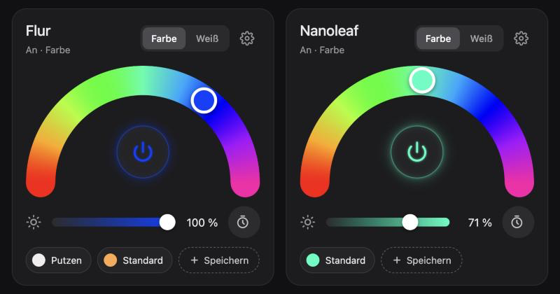

# Farbbogen-Licht (arc-light-card)

Lovelace-Karte für Home Assistant: Farbe oder Weiß in einem Halbkreis wischen, Ein/Aus in der Mitte,
Helligkeit, Auto-Aus und echte Home-Assistant-Szenen – alles direkt in der Kachel.

**[Testseite ausprobieren](https://lreinl.github.io/arc-light-card/)** – läuft gegen ein simuliertes
Home Assistant im Browser, ohne Installation.



## Funktionen

- **Farbe / Weiß** – Halbkreis mit Farbton (Rot bis Pink, kein Rot an beiden Enden) oder Farbtemperatur
  im Bereich, den die Lampe kann.
- **Ein/Aus** in der Mitte mit einem dezenten Schein in der aktuellen Lichtfarbe; beim Ausschalten blendet
  die ganze Karte weich aus.
- **Helligkeit** als Regler in der Lichtfarbe.
- **Auto-Aus** – ein Tipp startet einen Timer, danach geht das Licht aus (Dauer im Zahnrad-Menü).
- **Szenen** – die Karte zeigt automatisch alle Home-Assistant-Szenen, die dieses Licht enthalten.
  „+ Speichern" legt aus dem aktuellen Licht eine neue Szene an; im Zahnrad-Menü lassen sich Szenen
  sortieren, umbenennen, überschreiben und löschen. Die Szenen sind normale HA-Szenen und funktionieren
  auch in Automationen und Sprachbefehlen.
- **Grafischer Editor** im Dashboard-Bearbeitungsmodus.

## Installation

### Über HACS (empfohlen)

1. HACS öffnen → ⋮ → **Benutzerdefinierte Repositories**.
2. `https://github.com/lreinl/arc-light-card` eintragen, Typ **Dashboard**, hinzufügen.
3. „Farbbogen-Licht" suchen, **Herunterladen**, Browser neu laden.

HACS legt die Datei lokal unter `/config/www/community/arc-light-card/` ab und meldet neue Versionen als
Update in Home Assistant.

### Manuell

1. `arc-light-card.js` aus dem [neuesten Release](https://github.com/lreinl/arc-light-card/releases/latest)
   nach `/config/www/` kopieren.
2. Einstellungen → Dashboards → ⋮ → Ressourcen → `/local/arc-light-card.js` als **JavaScript-Modul** hinzufügen.

## Konfiguration

```yaml
type: custom:arc-light-card
entity: light.flur_lampen
name: Flur          # optional
hue_end: 320        # optional, Ende des Farbbogens in Grad
show_scenes: true   # optional, Standard für die Szenen-Leiste
grid_options:
  columns: 12
  rows: auto
```

Szenen heißen `<Name> · <Szene>` (z. B. „Flur · Putzen") und erscheinen in der Kachel als „Putzen".

### Auto-Aus

Die Taste nutzt pro Licht einen Timer `timer.auto_aus_<object_id>` und die Automation
[`licht | auto-aus`](examples/auto-aus-automation.yaml). Einmal die Automation anlegen, danach richtet
„Auto-Aus einrichten" im Zahnrad-Menü Timer und Auslöser für jedes weitere Licht selbst ein.

## Entwicklung

Alles steckt in `arc-light-card.js` – ohne Build-Schritt. Lokal testen:

```bash
python3 -m http.server 8765
```

Dann <http://127.0.0.1:8765/> öffnen. `demo/mock-hass.js` simuliert Lichter, Szenen, Timer und
Benutzer-Einstellungen.

Neue Version veröffentlichen: `ARC_VERSION` in `arc-light-card.js` erhöhen, committen und einen
passenden Tag pushen (`v1.0.1`). Der Release-Workflow legt das GitHub-Release an, HACS meldet es als Update.

## Lizenz

MIT
